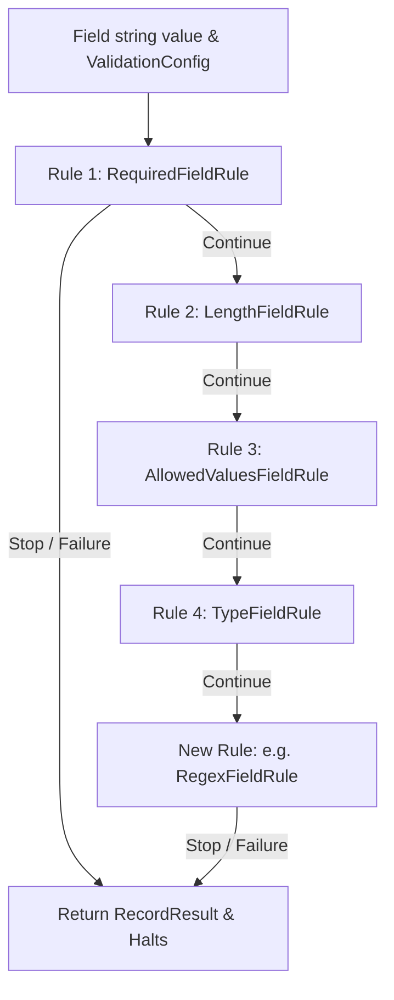

# Field Rule Creation Skill

This skill explains how to add new validation rules to the extensible `IFieldRule` pipeline in `csv-validate`.

---

## 1. Rule Pipeline Architecture

Validation in `ValidatorService` evaluates a chain of `IFieldRule` implementations for each field in a row:



---

## 2. Implementing `IFieldRule`

Rules implement `validator.Services.Rules.IFieldRule`:

```csharp
public interface IFieldRule
{
    FieldRuleResult Validate(int lineCount, int fieldIndex, string field, ValidationConfig config);
}
```

### Example: Adding a Regex Validation Rule

In `validator/Services/Rules/FieldRules.cs`:

```csharp
using System.Text.RegularExpressions;
using validator.Models;
using validator.Services.Interfaces;

namespace validator.Services.Rules;

/// <summary>
/// Validates that a non-empty field matches an optional regex pattern configured on the column.
/// </summary>
public class RegexFieldRule : IFieldRule
{
    public FieldRuleResult Validate(int lineCount, int fieldIndex, string field, ValidationConfig config)
    {
        // If no regex pattern is defined, pass cleanly
        if (string.IsNullOrWhiteSpace(config.RegexPattern))
        {
            return new FieldRuleResult(null, true);
        }

        if (!Regex.IsMatch(field, config.RegexPattern))
        {
            var message = RuleMessageFormatter.FormatErrorMessage(
                fieldIndex, config.Name, field,
                $"Value '{field}' does not match pattern '{config.RegexPattern}'",
                config.ErrorMessage);
            return new FieldRuleResult(new RecordResult(lineCount, fieldIndex, config.Name, field, false, message), false);
        }

        return new FieldRuleResult(null, true);
    }
}
```

---

## 3. Extending `ValidationConfig` (If Applicable)

If the new rule introduces new specification properties, add them to `validator/Models/ValidationConfig.cs`:

```csharp
public class ValidationConfig
{
    // ... existing properties ...

    [JsonProperty("regexPattern")]
    public string? RegexPattern { get; set; }
}
```

---

## 4. Registering the Rule in `ValidatorService`

In `validator/Services/ValidatorService.cs`:
Add the new rule to the default rule list in the parameterless / default constructor:

```csharp
public ValidatorService(IHeaderValidator headerValidator, ITypeValidator typeValidator)
{
    _headerValidator = headerValidator;
    _typeValidator = typeValidator;
    _fieldRules = new List<IFieldRule>
    {
        new RequiredFieldRule(),
        new LengthFieldRule(),
        new AllowedValuesFieldRule(),
        new TypeFieldRule(_typeValidator),
        new RegexFieldRule() // <-- Added
    };
}
```

---

## 5. Authoring Unit Tests

Add tests in `validator.Tests/ValidatorServiceTests.cs`:

```csharp
[Fact]
public void ProcessFileWithConfig_DescriptiveError_WhenRegexFails()
{
    var config = new FileConfig
    {
        FileType = "Test",
        Delimiter = ",",
        HeaderLine = false,
        ValidationConfigs = new List<ValidationConfig>
        {
            new() { Index = 0, Name = "PostalCode", Type = "string", RegexPattern = @"^\d{5}$" }
        }
    };

    var tempFile = Path.GetTempFileName();
    try
    {
        File.WriteAllText(tempFile, "ABCDE\n");
        var results = _validatorService.ProcessFileWithConfig(tempFile, config);

        Assert.False(results[0].IsValid);
        Assert.Contains("does not match pattern", results[0].RecordResults[0].ErrorMessage);
    }
    finally
    {
        if (File.Exists(tempFile)) File.Delete(tempFile);
    }
}
```

---

## 6. Verification

Verify that all existing tests and new rule tests succeed:

```bash
export PATH="$PATH:/usr/local/share/dotnet"
make run-tests
```
