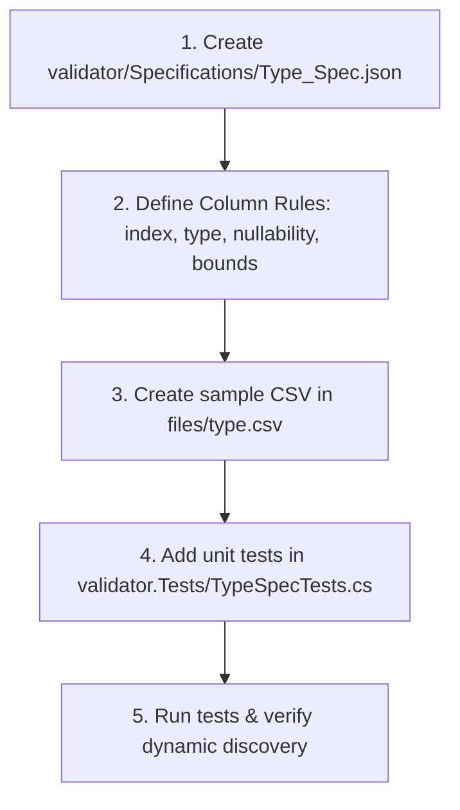

# Specification Authoring Skill

This skill guides the end-to-end process of defining a new delimited file specification, adding sample test fixtures, and writing automated verification tests.

---

## 1. Specification Lifecycle Workflow



---

## 2. Specification Template

Create a new file `validator/Specifications/<Type>_Spec.json`:

```json
{
  "fileType": "Employee",
  "delimiter": ",",
  "headerLine": true,
  "validationConfigs": [
    {
      "index": 0,
      "name": "EmployeeId",
      "type": "string",
      "isNullable": false,
      "minLength": 4,
      "maxLength": 10,
      "errorMessage": "EmployeeId must be 4 to 10 characters."
    },
    {
      "index": 1,
      "name": "Department",
      "type": "string",
      "isNullable": false,
      "allowedValues": [ "Engineering", "Sales", "Support", "HR" ],
      "errorMessage": "Department must be Engineering, Sales, Support, or HR."
    },
    {
      "index": 2,
      "name": "Salary",
      "type": "decimal",
      "isNullable": false,
      "errorMessage": "Salary must be a valid decimal number."
    },
    {
      "index": 3,
      "name": "HireDate",
      "type": "date",
      "isNullable": true,
      "formats": [ "yyyy-MM-dd" ],
      "errorMessage": "HireDate must follow yyyy-MM-dd."
    }
  ]
}
```

### Key Checklist
- **`index`**: Must be 0-based, sequential (`0, 1, 2, ...`).
- **`type`**: Must be one of `string`, `int`, `bool`, `date`, `datetime`, `double`, `decimal`.
- **`isNullable`**: Set `false` for mandatory columns, `true` for optional fields where `""` is valid.
- **`validationConfigs`**: Must not be empty, otherwise `SpecificationSelector` hides it from available types.

---

## 3. Creating Sample Fixtures (`files/`)

Create `files/<type>.csv` with sample records representing both valid cases and known boundary inputs:

```csv
EmployeeId,Department,Salary,HireDate
EMP001,Engineering,85000.50,2024-01-15
EMP002,Sales,62000.00,2023-11-01
EMP003,HR,55000.00,
```

---

## 4. Writing Unit Tests

Create `validator.Tests/<Type>SpecTests.cs` using the standard fixture testing pattern:

```csharp
using validator.Services;
using validator.Services.Rules;
using Xunit;

namespace validator.Tests;

public class EmployeeSpecTests
{
    private readonly SpecificationSelector _selector = new();
    private readonly ValidatorService _validator;

    public EmployeeSpecTests()
    {
        var typeValidator = new TypeValidator();
        var rules = new List<IFieldRule>
        {
            new RequiredFieldRule(),
            new LengthFieldRule(),
            new AllowedValuesFieldRule(),
            new TypeFieldRule(typeValidator)
        };
        _validator = new ValidatorService(new HeaderValidator(), typeValidator, rules);
    }

    [Fact]
    public void EmployeeSpec_IsDiscovered_BySelector()
    {
        var types = _selector.GetAvailableFileTypes();
        Assert.Contains("Employee", types);
    }

    [Fact]
    public void EmployeeSpec_ValidRow_PassesValidation()
    {
        var config = _selector.GetConfiguration("Employee");
        var tempFile = Path.GetTempFileName();
        try
        {
            File.WriteAllLines(tempFile, new[]
            {
                "EmployeeId,Department,Salary,HireDate",
                "EMP001,Engineering,85000.50,2024-01-15"
            });

            var results = _validator.ProcessFileWithConfig(tempFile, config);
            Assert.True(results.All(r => r.IsValid));
        }
        finally
        {
            if (File.Exists(tempFile)) File.Delete(tempFile);
        }
    }
}
```

---

## 5. Verification

Execute the test suite to verify spec loading and parsing:

```bash
export PATH="$PATH:/usr/local/share/dotnet"
dotnet test ./validator.Tests/validator.Tests.csproj --filter "FullyQualifiedName~EmployeeSpec"
```
