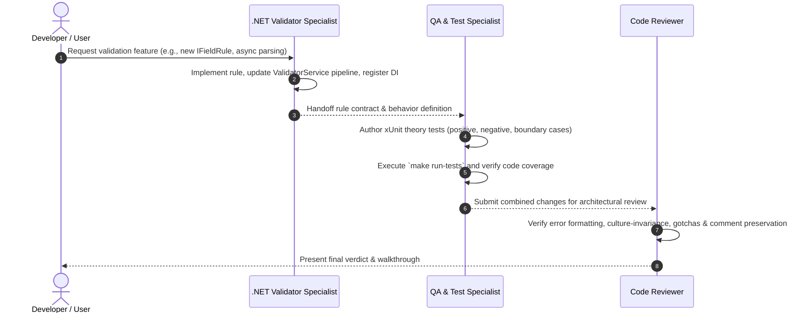
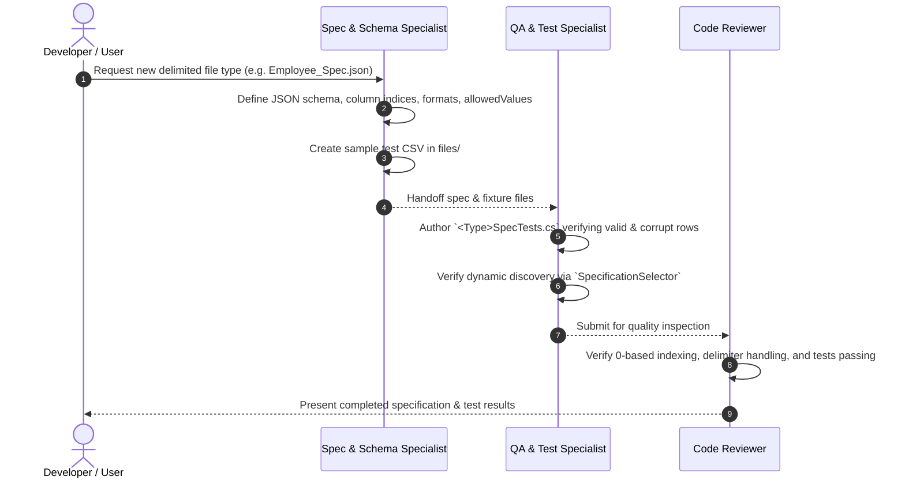

# AGENTS.md

# csv-validate Agent Registry & Collaboration Protocol

Welcome to the **csv-validate** AI Agent Operating Framework. This repository is configured for autonomous and pair-programming agentic development, where specialized AI personas and human developers collaborate to build, maintain, and review validation features cleanly, efficiently, and safely.

---

## 🤖 Specialized Agent Roster

| Agent Name | Identifier | Primary Domain | Core Specialty | Specification Record |
| :--- | :--- | :--- | :--- | :--- |
| **.NET Validator Specialist** | `dotnet-validator-specialist` | `validator/Services/`<br>`validator/Models/`<br>`validator/Program.cs`<br>`validator/App.cs` | .NET 10 host, pipeline architecture, `IFieldRule` rules, streaming performance, DI | [`.agents/agents/dotnet-validator-specialist/agent.md`](.agents/agents/dotnet-validator-specialist/agent.md) |
| **Spec & Schema Specialist** | `spec-schema-specialist` | `validator/Specifications/*.json`<br>`files/*.csv`<br>`validator/Models/FileConfig.cs` | JSON specification authoring, validation rules, type mappings, sample test fixtures | [`.agents/agents/spec-schema-specialist/agent.md`](.agents/agents/spec-schema-specialist/agent.md) |
| **QA & Test Specialist** | `qa-test-specialist` | `validator.Tests/**`<br>`scripts/**`<br>`.github/workflows/build.yml` | xUnit testing, Theory/InlineData parameterization, edge-case generation, coverage | [`.agents/agents/qa-test-specialist/agent.md`](.agents/agents/qa-test-specialist/agent.md) |
| **Code Reviewer** | `code-reviewer` | Entire repository | Quality gatekeeping, PR reviews, architectural compliance, regression auditing | [`.agents/agents/code-reviewer/agent.md`](.agents/agents/code-reviewer/agent.md) |

---

## 🗺️ Repository Structure at a Glance

```
csv-validate/
├── .agents/                               # Agentic directory
│   ├── agents/                            # Specialized agent personas
│   │   ├── code-reviewer/agent.md
│   │   ├── dotnet-validator-specialist/agent.md
│   │   ├── qa-test-specialist/agent.md
│   │   └── spec-schema-specialist/agent.md
│   └── skills/                            # Progressive-disclosure skills
│       ├── cli-runner/SKILL.md
│       ├── field-rule-creation/SKILL.md
│       ├── run-and-test/SKILL.md
│       └── spec-authoring/SKILL.md
├── .github/workflows/                     # CI/CD pipelines
│   └── build.yml
├── files/                                 # Sample input CSV datasets
│   ├── account.csv
│   └── transactions.csv
├── scripts/                               # Developer shell scripts
│   ├── test-and-report.sh
│   └── openreport.sh
├── validator/                             # Core .NET 10 application
│   ├── Models/                            # Domain entities & config models
│   ├── Services/                          # Engine services & rule pipeline
│   │   ├── Interfaces/                    # Service abstractions
│   │   └── Rules/                         # IFieldRule implementations
│   ├── Specifications/                    # JSON file validation schemas
│   ├── Utils/                             # Shared validation utilities
│   ├── App.cs                             # Console workflow orchestration
│   ├── Program.cs                         # Generic Host & DI startup
│   ├── appsettings.json                   # Runtime settings (Inbox/Outbox)
│   └── validator.csproj
├── validator.Tests/                       # xUnit test project (103+ unit tests)
│   └── validator.Tests.csproj
├── AGENTS.md                              # This master agent directory
├── GEMINI.md                              # Antigravity system rules & commands
├── CLAUDE.md                              # Legacy guidelines for Claude Code
├── README.md                              # Project documentation
├── TODO.md                                # Development backlog
└── makefile                               # Build & test task runner
```

---

## 🔄 Agent Workflows & Collaboration Protocols

To ensure consistent quality across features and bug fixes, agents adhere to established handoff lifecycles:

### 1. Engine & Rule Development Lifecycle



### 2. Specification & Schema Authoring Lifecycle



---

## 🧭 Universal Operational Directives

All agents operating in `csv-validate` must respect the following core invariants:

1. **Test-First Integrity:**
   - Every modification to `validator/` must be validated against `make run-tests`.
   - Never consider a task complete if any existing test fails.
2. **Modular Rule Pipeline:**
   - Field-level validation rules must implement `IFieldRule` and be placed in `validator/Services/Rules/`.
   - Never embed ad-hoc parsing or field-specific validation directly into `ValidatorService.cs`.
3. **Culture Invariance:**
   - Numbers, dates, and decimals must always parse culture-invariantly using `CultureInfo.InvariantCulture` to prevent locale-dependent bugs.
4. **Descriptive Error Messaging:**
   - Error messages must use `RuleMessageFormatter` to specify line count, field index, field name, specific failure reason, and configured error message.
5. **Path Resolution Safety:**
   - Remember that `SpecificationSelector` loads specifications from `AppContext.BaseDirectory` in tests, while the CLI app resolves relative to the working directory. Ensure all file operations accommodate both contexts.
6. **Preservation of Existing Code:**
   - Apply surgical edits. Do not rewrite files unnecessarily, and never strip unrelated comments or XML documentation.
